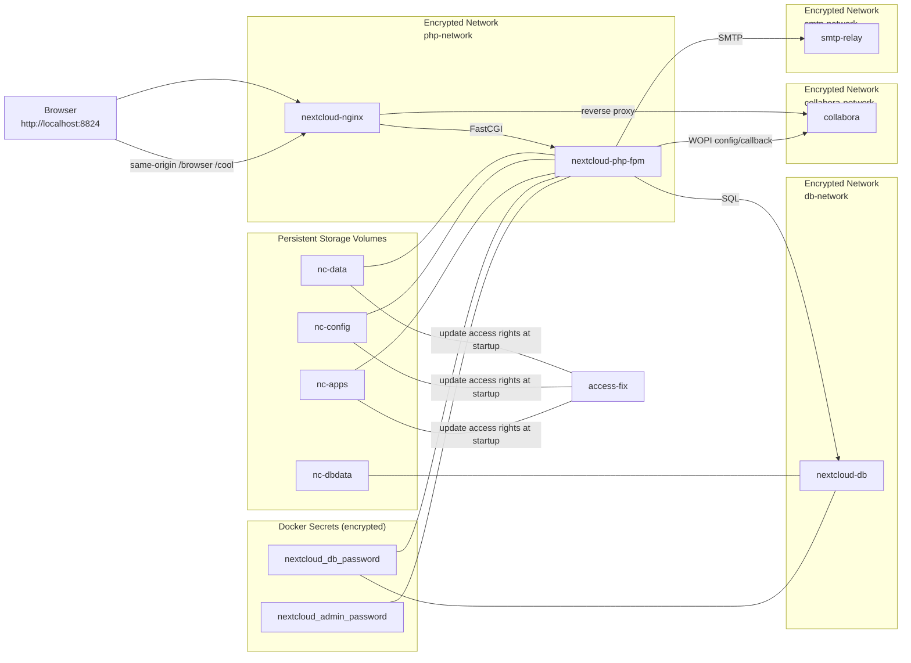

# Minimalistic Secure Nextcloud Docker Images

Lean, hardened Nextcloud stack with two images:

- [mwaeckerlin/nextcloud:nginx]: NGINX Nextcloud frontend in only 317MB
- [mwaeckerlin/nextcloud:php-fpm]: PHP‑FPM Nextcloud backend in only 647MB

This splitting is in accordance to Docker philosophy of having only one server process per image and to NGINX which splits PHP processing into a separate service. It therefore also follows strong microservice architecture.

Both together are the most lean and secure images for Nextcloud:
 - extremely small size, minimalistic dependencies
 - no shell, only the server command
 - small attack surface
 - starts as non-root user
 - configuration and secrets hidden in the backend service only
 - all PHP files are empty stubs in the NGINX frontend
 - passwords never in environment variables, delivered as Docker secrets

Most of the combined 964MB footprint is the Nextcloud distribution itself. Each image keeps only the part its server reads: `nginx` the files a browser requests, `php-fpm` the PHP code with empty JavaScript and CSS files and no source maps.

Compared to the official [nextcloud] image, this package has:
 - Less attack surface.
 - Better encapsulation.
 - Running as non-privileged user.
 - Much smaller: ~317MB (nginx) + ~647MB (php-fpm) vs. ~1.43GB for the official `nextcloud:latest` image.
 - Clear segmentation: only NGINX can reach PHP, only PHP can reach the DB; networks are isolated and marked `encrypted` (e.g. when run in Docker Swarm).
 - Headless: no shell, no package manager at runtime.
 - Configurable via environment (NGINX through envwrap templates, Nextcloud via `custom.config.php` reading `getenv()`).
 - No Nextcloud PHP file available in NGINX frontend, all PHP files emptied.
 - Passwords never exposed: delivered as Docker secrets, mounted as read-only tmpfs inside containers.


## Volumes / Persistence

All mutable Nextcloud data lives in these directories:

| Mount in container | Docker volume | Content                    |
|--------------------|---------------|----------------------------|
| `/app/data`        | `nc-data`     | User files and uploads     |
| `/app/config`      | `nc-config`   | `config.php` and fragments |
| `/app/custom_apps` | `nc-apps`     | User-installed apps        |

### Permissions

The runtime user comes from the base images and is not root. The helper service `access-fix` (based on `mwaeckerlin/allow-write-access`) runs once at startup to set the correct ownership of the volumes; after that the volumes keep their owner.

### First-run initialization

On first start, Docker initializes the `nc-config` volume from the image content of `/app/config`. This seeds these PHP config files:

- `autoconfig.php`: consumed by Nextcloud on the first web request to perform a fully headless installation (reads DB credentials from Docker secrets, admin credentials from the secret or auto-generates them).
- `custom.config.php`: a persistent config fragment always loaded alongside `config.php`; reads `HOST`, `PROTOCOL`, `WEBROOT`, `DEBUG` from environment variables at every request.


## Secrets

Passwords are delivered as Docker secrets — never as plain environment variables. They are mounted read-only as tmpfs files at `/run/secrets/` and never appear in `docker inspect` or process listings.

The stack needs these secrets:

| Secret name              | Used by                               | Purpose                        |
|--------------------------|---------------------------------------|--------------------------------|
| `nextcloud_db_password`  | `nextcloud-php-fpm`, `nextcloud-db`   | MariaDB password               |
| `nextcloud_admin_password` | `nextcloud-php-fpm`                 | Initial Nextcloud admin password |
| `nextcloud_smtp_password` | `nextcloud-php-fpm`, optional        | Password of an external mail server; see [Mail server](#mail-server) |
| `nextcloud_redis_password` | `nextcloud-php-fpm`, optional       | Password of Redis, where `REDIS_PASSWORD` of `mwaeckerlin/redis` sets one |
| `nextcloud_signaling_secret` | `nextcloud-php-fpm`, with Talk    | Secret Nextcloud shares with the signaling server; see [Talk high-performance backend](#talk-high-performance-backend) |
| `talk_signaling_config`  | `signaling`, with Talk                | Configuration of the signaling server, its secrets included |

### Creating secrets

In production on a docker swarm, use secrets. For `docker compose`, passwords are passed via environment variables, which Docker Compose reads from a `.env` file. For testing copy the sample: `cp .env.sample .env`, for more security, generate strong random passwords once:

```sh
printf "NEXTCLOUD_DB_PASSWORD=%s\nNEXTCLOUD_ADMIN_PASSWORD=%s\n" \
  "$(pwgen -sy 40 1)" "$(pwgen -sy 40 1)" > .env
```

Keep `.env` out of version control (added to `.gitignore`). Docker Compose picks it up automatically on `docker compose up`.

Install `pwgen` if needed: `apt install pwgen` / `brew install pwgen`.

If `nextcloud_admin_password` is absent or empty, a random password is generated and written to the container log:

```sh
docker compose logs nextcloud-php-fpm | grep 'generated admin password'
```

#### Docker Swarm secrets

For multi-node or high-security deployments, use Docker Swarm secrets instead. Change the `secrets:` block in `docker-compose.yml` to:

```yaml
secrets:
  nextcloud_db_password:
    external: true
  nextcloud_admin_password:
    external: true
```

Then initialize Swarm and create the secrets (once per swarm):

```sh
docker swarm init
docker secret create nextcloud_db_password    - <<<$(pwgen -sy 40 1)
docker secret create nextcloud_admin_password - <<<$(pwgen -sy 40 1)
```

The `<<<` herestring avoids a trailing newline. Swarm secrets are encrypted at rest and never exposed via `docker inspect`.


## Environment Variables

- **nextcloud-nginx**
  - `PHP_FPM_HOST` (default `nextcloud-php-fpm`): upstream FastCGI host.
  - `PHP_FPM_PORT` (default `9000`): upstream FastCGI port.
  - `ROOT` (default `/app`): document root served by NGINX.
  - `WEBROOT`: optional URL prefix such as `/nextcloud`; must match the PHP-FPM `WEBROOT` value.
  - `MAX_INPUT_TIME` (default `3600`): seconds NGINX waits for php-fpm (`fastcgi_read_timeout`, `fastcgi_send_timeout`); set it to the same value as on `nextcloud-php-fpm`.
  - `NOTIFY_PUSH_HOST` (default `notify-push`): push server of [Client Push](#client-push) behind `/push/`; NGINX answers 502 there while none runs.
  - `TALK_SIGNALING_HOST` (default `signaling`): signaling server of the [Talk high-performance backend](#talk-high-performance-backend) behind `/standalone-signaling/`; 502 while none runs.

- **nextcloud-php-fpm**
  - `ADMIN_USER`: Nextcloud admin login name; default `admin`.
  - `ADMIN_PWD`: admin password for the first installation; the secret `nextcloud_admin_password` takes precedence. Empty, Nextcloud installs on the first request with a generated password, which stands in the container log.
  - `HOST`: public hostname (e.g. `cloud.example.com`); always extends `trusted_domains` and is the base for generated public URLs. Empty together with `URL`, it is `localhost:8824`.
  - `URL`: the same setting as `HOST`, the name of the legacy image; `HOST` takes precedence when both are set.
  - `DOMAIN`: legacy alias for `HOST` (kept for backwards compatibility in startup/runtime fallback logic).
  - `UPLOAD_MAX_FILESIZE` (default `8G`): largest upload; sets `upload_max_filesize` and `post_max_size` of PHP.
  - `MEMORY_LIMIT` (default `1000M`): `memory_limit` of PHP; empty, it takes the value of `UPLOAD_MAX_FILESIZE`.
  - `MAX_INPUT_TIME` (default `3600`): seconds a request may take to arrive and to run; sets `max_input_time` and `max_execution_time` of PHP.
  - `MAX_REQUEST_WORKERS` (default `100`): most PHP processes at the same time, `pm.max_children` of php-fpm; see [Database connections](#database-connections).
  - `WAIT_SECONDS_FOR_MYSQL` (default `300`): seconds the first installation retries while the database does not answer; then php-fpm starts without it.
  - `OPCACHE_INTERNED_STRINGS_BUFFER` (default `32`) and `OPCACHE_MEMORY_CONSUMPTION` (default `128`): megabytes of OPcache for interned strings and for compiled code, variables of the base image `mwaeckerlin/php-fpm`; the admin overview warns at the PHP default of `8` for interned strings.
  - `SERVER_ID`: number from `0` to `511` that Nextcloud writes into the IDs it generates; every php-fpm on the same database needs its own. Unset, each container derives one from its host name.
  - `PROTOCOL`: public protocol; default `https`.
  - `SELF_CHECK_URL`: optional override for the generated CLI/self-check URL; by default it is derived from `PROTOCOL://HOST[/WEBROOT]`.
  - `WEBROOT`: URL sub-path if Nextcloud is not at `/` (e.g. `/nextcloud`); sets `overwritewebroot` and must match the NGINX `WEBROOT` value.
  - `DEBUG`: set to `1` to enable Nextcloud debug mode; default `0`.
  - `MYSQL_HOST`: database hostname; default `mysql`, set to `nextcloud-db` in the compose setup.
  - `MYSQL_USER`: database user; default `nextcloud`.
  - `MYSQL_DATABASE`: database name; default `nextcloud`.
  - `MYSQL_PASSWORD`: database password; the secret `nextcloud_db_password` takes precedence. Empty, Nextcloud installs with SQLite.
  - `MYSQL_ENV_MYSQL_USER`, `MYSQL_ENV_MYSQL_PASSWORD`, `MYSQL_ENV_MYSQL_DATABASE`: set by a docker link to a container named `mysql`; they take precedence over `MYSQL_USER`, `MYSQL_PASSWORD` and `MYSQL_DATABASE`, as in the legacy image.
  - `OFFICE_WOPI_URL`: internal Collabora endpoint; default `http://collabora:9980`.
  - `OFFICE_PUBLIC_WOPI_URL`: optional override for the public WOPI URL; by default it is derived from `PROTOCOL://HOST[/WEBROOT]`.
  - `OFFICE_CALLBACK_URL`: optional override for the internal callback URL; by default it is derived from `http://nextcloud-nginx:8080[/WEBROOT]`.
  - `OFFICE_WOPI_ALLOWLIST`: addresses or networks, separated by commas, that may fetch documents over WOPI, the allowlist of Nextcloud Office; empty, the private networks `10.0.0.0/8,172.16.0.0/12,192.168.0.0/16`, in which Collabora of the stack runs. Without an allowlist any host may fetch documents, and Nextcloud Office warns about it.
  - `APPSTORE_TIMEOUT`: app-store fetch timeout in seconds for installing `richdocuments`; default `600` (the ~12 MB store index aborts at Nextcloud's 120 s default on slow connections).
  - `MAIL_FROM_ADDRESS` (default `nextcloud`) and `MAIL_DOMAIN` (default: `HOST` without port): the sender of mails, `mail_from_address@mail_domain`.
  - `LOGLEVEL`: Nextcloud log level, `0` debug to `4` fatal; set, it overrides a level saved in `config.php`, e.g. a debug level `0` an earlier installation left there; unset, the saved level applies, otherwise `2`.
  - `LOG_MAX_SIZE` (default `100M`): largest size of `/app/data/nextcloud.log`. Nextcloud writes its log there, whatever `log_type` and `logfile` an earlier installation saved, so the log stays readable under Administration settings › Logging. `/usr/local/bin/log-follow.php` passes every line on to the container log and empties the file once it reaches this size; no rotated copy stays behind. Units `K`, `M`, `G`.
  - `TRUSTED_PROXIES`: addresses or networks, separated by spaces or commas, whose `X-Forwarded-For` Nextcloud reads as the client address. Unset, a list saved in `config.php` applies, otherwise the private networks `10.0.0.0/8 172.16.0.0/12 192.168.0.0/16`, in which Docker creates its networks. Trade-off: every container in these networks could claim another client address. A reverse proxy in front of `nginx` adds the real address on the right of `X-Forwarded-For`, and Nextcloud takes that one. Where clients reach the port of `nginx` directly and arrive with a private address, they can claim any address and so bypass the brute-force protection of the login. This happens through the routing mesh of a swarm (`ports` in mode `ingress`) and through `docker-proxy`. In that case `TRUSTED_PROXIES` names the address of the proxy, or the port is published in mode `host`.
  - `REDIS_HOST`, `REDIS_PORT` (default `6379`), secret `nextcloud_redis_password` or `REDIS_PASSWORD`: Redis for file locking and the cache all php-fpm containers share; the compose setup sets `REDIS_HOST: redis`. Unset, Nextcloud locks files in the database.
  - `NOTIFY_PUSH_HOST`: the push server of [Client Push](#client-push); set, the start installs the app `notify_push` and sends the clients to `<public URL>/push`. `NOTIFY_PUSH_ENDPOINT` sets another address.
  - `TALK_SIGNALING_HOST`: the signaling server of the [Talk high-performance backend](#talk-high-performance-backend); set, the start installs Talk and registers it at `<public URL>/standalone-signaling`. `TALK_SIGNALING_URL` sets another address.
  - `MAIL_SMTPHOST`, `MAIL_SMTPPORT`, `MAIL_SMTPSECURE`, `MAIL_SMTPNAME`, `MAIL_SMTPPASSWORD`: an external mail server; see [Mail server](#mail-server).
  - `NC_<key>`: Nextcloud itself reads every setting of `config.php` from a variable of that name, e.g. `NC_mail_smtpauthtype`; such a variable takes precedence over every config file.

- **collabora**
  - `COLLABORA_SERVER_NAME`: browser-visible host name for the office frontend; defaults to `HOST`.
  - `aliasgroup1`: allowlist of accepted WOPI origins. In this setup it must include both the internal Nextcloud URL and, if needed, the browser-facing local URL.

### Mail server

Nextcloud sends mails over SMTP to `smtp-relay:25`, the relay of the compose setup. Another server, an own Postfix, SendGrid or Gmail, is set in one of two ways:

- **Administration settings › Basic settings › Email server**, with «Send email» to test it. The server saved there stays in effect across restarts and new images; so does the mail server a legacy image left in `config.php`.
- **Variables of `nextcloud-php-fpm`**, which take precedence over what is saved:

| Variable | Meaning |
| --- | --- |
| `MAIL_SMTPHOST` | SMTP server, e.g. `smtp.gmail.com` |
| `MAIL_SMTPPORT` | its port, e.g. `587` for STARTTLS, `465` for TLS |
| `MAIL_SMTPSECURE` | `ssl` for TLS from the first byte (port 465); empty, Nextcloud uses STARTTLS where the server offers it |
| `MAIL_SMTPNAME` | user name; set, it switches the login on |
| secret `nextcloud_smtp_password` | password of that user; `MAIL_SMTPPASSWORD` where no secret is used |

```yaml
  nextcloud-php-fpm:
    environment:
      MAIL_SMTPHOST: smtp.sendgrid.net
      MAIL_SMTPPORT: 587
      MAIL_SMTPNAME: apikey
    secrets:
      - nextcloud_smtp_password
```

For Gmail it is `smtp.gmail.com`, port `465` with `MAIL_SMTPSECURE: ssl`, the Gmail address as `MAIL_SMTPNAME` and an app password of that Google account. For an own Postfix it is its host name and the port and login it offers.

Any other mail setting, and any setting of `config.php`, is set by the variable `NC_<key>` that Nextcloud reads itself, e.g. `NC_mail_smtpauthtype`; it takes precedence over everything above. The same order — variable, then saved value, then image default — holds for `default_phone_region` (default `CH`) and `maintenance_window_start` (default `1`).

### Further PHP settings

The base image `mwaeckerlin/php-fpm` also knows `POST_MAX_SIZE`, `MAX_EXECUTION_TIME` and `MAX_CHILDREN`. In this image they follow the variables of the legacy image and are not set on their own: `UPLOAD_MAX_FILESIZE` sets `post_max_size`, `MAX_INPUT_TIME` sets `max_execution_time`, `MAX_REQUEST_WORKERS` sets `pm.max_children`.

The base image `mwaeckerlin/php-fpm` declares `exec`, `shell_exec`, `system` and `passthru` off. The image runs without a shell on purpose, and PHP would still report these functions as available, so Talk and Nextcloud would take the failing call instead of their own way around it, logging «Unable to fork» and reporting an incompatible Apache; declared off, they skip them. A PHP setting without a variable above goes into an `.ini` file mounted into `/usr/local/etc/php/conf.d/` of `nextcloud-php-fpm`. The five limits that `UPLOAD_MAX_FILESIZE`, `MEMORY_LIMIT` and `MAX_INPUT_TIME` set reach php-fpm as `-d` options, which take precedence over every `.ini` file, so they change only through the variables.

### Database connections

Every PHP process holds one database connection while it answers a request and closes it when the request ends. php-fpm starts at most `MAX_REQUEST_WORKERS` processes, 100 by default, set as `pm.max_children` in `/usr/local/etc/php-fpm.d/zz-nextcloud.conf`, so Nextcloud never opens more than that many connections for requests, plus one for each running background job. The database accepts `max_connections` connections, 151 by default in MariaDB and MySQL.

The two limits work together:

- Requests above `MAX_REQUEST_WORKERS` wait in the queue of `php-fpm` until a process is free; NGINX answers with 504 only after `MAX_INPUT_TIME` seconds.
- Connections above `max_connections` fail at once, and Nextcloud shows «Too many connections» (error 1040).

So `max_connections` must stay above `MAX_REQUEST_WORKERS` with room for background jobs, backups and administration. Nextcloud gets no root password and never changes the limit of the database. Where the database also serves other clients, its limit is raised as an option of its own server:

```yaml
  nextcloud-db:
    image: mariadb:11.8
    command: --max-connections=500
```

Every open connection takes memory in the database server, so a higher limit needs the memory for it where the database runs with a memory limit.

### Health check

The image `mwaeckerlin/nextcloud:php-fpm` carries a `HEALTHCHECK`, so Docker Compose and Docker Swarm use it without a `healthcheck` block in the compose file. Every 10 seconds `/usr/local/bin/health.php` sends a FastCGI request for `status.php` to the local php-fpm, the way NGINX does. As in the legacy image, it reports healthy when php-fpm answers and Nextcloud is installed, not in maintenance mode, and needs no database upgrade; otherwise it prints the reason, e.g. `unhealthy: Nextcloud is in maintenance mode`. The image has no shell and no HTTP client, so PHP itself speaks FastCGI, through `/usr/local/bin/fastcgi.php` of the base image `mwaeckerlin/php-fpm`; this check replaces the ping check of that base image.

The start period is 60 minutes, one and a half times an upgrade of 40 minutes, so Docker Swarm does not replace a task in the middle of a long upgrade. During the start period the check runs every 5 seconds, so a start without upgrade is healthy within seconds; checks that fail during it do not count, and the first healthy check ends it. The interval of 5 seconds needs Docker 25 or newer; an older Docker checks every 10 seconds from the start. After the start period, six failed checks in a row, one minute, mark the container unhealthy, and Docker Swarm then replaces it. A check without an answer within 5 seconds counts as failed; a php-fpm that answers at all answers within that time, and a single slow answer under load leaves the container healthy. The start logs every step with its duration, so the log of an upgrade shows how long it took. `nextcloud-nginx` waits with `depends_on: condition: service_healthy` until php-fpm is healthy. A `healthcheck` block in the compose file overrides any of the values:

```yaml
  nextcloud-php-fpm:
    healthcheck:
      start_period: 120m
```

The result of the last checks stands in `docker inspect --format '{{json .State.Health}}' <container>`.

### Integrity check

Nextcloud compares every file of core and of each app with the hashes in `core/signature.json` and `appinfo/signature.json`, which a certificate signs, and reports a difference under Administration settings › Overview. The `php-fpm` image changes files of the release, so the build signs it again:

1. `sign-release.php` creates a CA and a certificate named `core` in a build stage of its own.
2. It appends the CA to `resources/codesigning/root.crt`, after the Nextcloud CA. Nextcloud loads every certificate in that file as a CA, in the integrity check and in the installer of the App Store.
3. It signs core and every shipped app with `occ integrity:sign-core` and `occ integrity:sign-app`; a certificate named `core` may sign apps too.
4. The private keys stay in that build stage; nobody can sign with them afterwards.

The check stays active: `occ integrity:check-core` and `occ integrity:check-app --all` pass, apps from the App Store still verify against the Nextcloud CA, and a changed file is reported.

### Start and background jobs

The start first waits up to `WAIT_SECONDS_FOR_MYSQL` until `occ status` answers, logging every attempt, and only then decides between installation and upgrade. Every step is logged when it begins, with the output of `occ` as it comes, and with its result and duration when it ends. Every start of an installed Nextcloud runs, as the legacy image does and before php-fpm answers: `maintenance:mode --off`, `upgrade`, `maintenance:repair` (with `--include-expensive` and another `upgrade` when it fails), `db:add-missing-indices`, `db:add-missing-columns`, `db:convert-filecache-bigint`, `db:convert-mysql-charset`, `db:add-missing-primary-keys`, and it reinstalls an app in `custom_apps` that an update left nested in itself. A new image of the next major version therefore upgrades the installation when it starts.

The paths of the legacy image lead to the same place: `/var/www/nextcloud` is a link to `/app`, so the `datadirectory` `/var/www/nextcloud/data` in a `config.php` of the legacy image and a volume mounted at `/var/www/nextcloud/data` or `/var/www/nextcloud/config` work unchanged. The `apps` volume of the legacy image holds the shipped apps of its old version beside the installed ones; it is mounted at `/app/custom_apps`, because at `/var/www/nextcloud/apps` it would hide the shipped apps of the new version.

Beside php-fpm, `/usr/local/bin/cron.php` runs `/app/cron.php` every 15 minutes and `occ files:scan --all` once a day; the first run switches Nextcloud's background jobs to cron mode. Once per start it also runs, while Nextcloud already answers, `/usr/local/bin/db-auth.php`, `occ db:add-missing-indices` again, `/usr/local/bin/row-format.php` and `/usr/local/bin/setup-checks.php`. The last one runs the setup checks of the admin overview with `occ setupchecks`, repairs what an `occ` command repairs, runs them again and writes every error and warning that stays into the container log, as lines `nextcloud-setup-check: …`, ending with `no errors and no warnings` or the number that remains.

### Admin overview

Administration settings › Overview lists the setup checks of Nextcloud. The tests run every check through the route this page calls and fail on every error and warning, except the ones below that need a service outside these images.

The images settle these checks themselves:

| Check | What the images do |
| --- | --- |
| MySQL row format | Tables created before MariaDB 10.2.2 and MySQL 5.7.9 kept `ROW_FORMAT=COMPACT`. The migrations of Nextcloud never change the format of an existing table, and its collation repair touches only tables with a wrong collation, so no `occ` command fixes them. `row-format.php` converts each such table with `ALTER TABLE … ROW_FORMAT=DYNAMIC, ALGORITHM=INPLACE, LOCK=NONE` and logs every table with its duration; Nextcloud reads and writes the table meanwhile. |
| Database missing indices, columns, primary keys, big integer conversion, mimetype migration, system address book | `occ db:add-missing-indices` at the start and once more beside php-fpm; the others through `setup-checks.php` with the `occ` command each check names. |
| JavaScript source maps | `nginx` keeps `apps/settings/js/map-test.js.map`, the one map file the check requests. |
| PHP OPcache | `OPCACHE_INTERNED_STRINGS_BUFFER`, default `32`. |
| Configuration server ID | `SERVER_ID`, or a value derived from the host name of the container. |
| Forwarded for headers | `TRUSTED_PROXIES`, default the private networks of Docker. |
| Transactional file locking | Redis with `REDIS_HOST`, the service `redis` of the compose setup. |
| Client Push | the image `mwaeckerlin/nextcloud:notify-push`, see [Client Push](#client-push). |
| High-performance backend | `docker-compose.talk.yml`, see [Talk high-performance backend](#talk-high-performance-backend). |
| Errors in the log of a fresh installation | The start creates `appdata/theming/global`, without which the background job `MigrateBackgroundImages` of Nextcloud fails once. |
| Errors in the log, code integrity, memory cache | the log file for `logreader` with `LOG_MAX_SIZE`, the build signs the release again, APCu as local cache. |
| Database version | The compose setup runs `mariadb:11.8`, the newest MariaDB that Nextcloud 33 to 35 support; the tag `mariadb` without a version delivers MariaDB 13, and the admin overview warns about it. A database outside this stack needs a version Nextcloud supports. |
| Database configuration (app `serverinfo`) | The compose setup starts MariaDB with `--innodb-log-file-size=256M`; the image default of 96M is below the 128M the check asks for. A database outside this stack needs the same setting. The checks of `serverinfo` that count events wait for 24 hours of uptime of the database. |
| Login method of the database account | MySQL 8.0 deprecates `mysql_native_password`, 8.4 switches it off by default and 9.0 removes it. `db-auth.php` reads the method of its own account on MySQL and, while it is `mysql_native_password`, writes a line `nextcloud-db-auth: warning: …` into the container log with the `ALTER USER` for that account. Switching the method needs the privilege `CREATE USER`, which Nextcloud does not have, so the administrator of the database runs it; PHP then logs in with `caching_sha2_password` without TLS as well. MariaDB is left as it is. |

These need the administrator:

- **Reverse proxy:** `.well-known` URLs and `Strict-Transport-Security` are answered by the proxy in front of `nginx`. It forwards every `/.well-known` path except `acme-challenge` to `nginx` and sets HSTS on forwarded responses; [mwaeckerlin/reverse-proxy] does both from version 2.0.7.
- **MySQL 9:** an installation on MySQL whose accounts still log in with `mysql_native_password` needs, before the upgrade to MySQL 9: `ALTER USER 'nextcloud'@'%' IDENTIFIED WITH caching_sha2_password BY '<password>';`, the same for `'root'@'%'` and `'root'@'localhost'` with the root password, and the option `--mysql-native-password` removed from the command of the server, because MySQL 9 knows neither the method nor the option.
- **Saved debug level:** an installation of the legacy image may hold `loglevel` `0` in `config.php`, which writes every debug line into the log. `LOGLEVEL=2` overrides it.
- **Code integrity of an earlier scan:** Nextcloud shows the result of the last full scan until **Rescan** runs it again; an app that was updated since appears with files it no longer has.
- **AppAPI deploy daemon** (check `OCA\AppAPI\SetupChecks\DaemonCheck`): AppAPI installs external apps as containers of their own and needs a daemon that starts them through the Docker socket of the host. These images do not provide it: a container with the Docker socket controls every container of the host and is root there. Whoever wants external apps registers a daemon under Administration settings › AppAPI, as the [AppAPI documentation](https://docs.nextcloud.com/server/latest/admin_manual/exapps_management/AppAPIAndExternalApps.html) describes; whoever does not disables the app with `occ app:disable app_api`, and the warning disappears.

### Client Push

Desktop and mobile clients of Nextcloud learn about changed files from a push server instead of asking every few seconds, and the app Talk delivers its notifications at once. The image `mwaeckerlin/nextcloud:notify-push` holds the push server of the app `notify_push` («Client Push»), the static binary of its latest release and nothing else.

1. Run the service `notify-push` of `docker-compose.yml`: it mounts the `config` volume read-only and reads the database from `config.php`, takes Redis from `REDIS_URL` (default `redis://redis`) and checks its clients against Nextcloud at `NEXTCLOUD_URL` (default `http://nextcloud-nginx:8080`; with a `WEBROOT` it ends with it, as `docker-compose.yml` sets it). It needs the networks of the database, of Redis and of `nginx`.
2. Set `NOTIFY_PUSH_HOST: notify-push` on `nextcloud-php-fpm` and `REDIS_HOST`; Client Push needs Redis.
3. On the next start Nextcloud installs `notify_push` from the App Store and sends the clients to `<public URL>/push`, which `nginx` forwards to the push server.

`occ notify_push:self-test` in `nextcloud-php-fpm` checks the whole chain. The App Store updates the app, and the weekly rebuild of the image takes the matching release of the push server along.

### Talk high-performance backend

Without it Talk carries calls of two or three participants, and the admin overview reports an error. `docker-compose.talk.yml` adds the signaling server of struktur AG (`strukturag/nextcloud-spreed-signaling`) and NATS, its message bus:

```sh
docker compose -f docker-compose.yml -f docker-compose.talk.yml up
```

`nginx` forwards `/standalone-signaling/` to the signaling server. With `TALK_SIGNALING_HOST` set, the start of `nextcloud-php-fpm` installs Talk from the App Store and registers the signaling server at `<public URL>/standalone-signaling`, or at `TALK_SIGNALING_URL`; the shared secret comes from the secret `nextcloud_signaling_secret` and never stands on a command line.

The signaling server reads its whole configuration, its secrets included, from the secret `talk_signaling_config`. Its content, with the four values generated once, for example with `pwgen -s 64 1`:

```ini
[http]
listen = 0.0.0.0:8080

[sessions]
hashkey = <64 random characters>
blockkey = <exactly 16 random characters>

[clients]
internalsecret = <random characters>

[backend]
backends = nextcloud
timeout = 10
connectionsperhost = 8

[nextcloud]
# the public URL of Nextcloud, with its WEBROOT
urls = https://cloud.example.com
secret = <the same value as the secret nextcloud_signaling_secret>

[nats]
url = nats://nats:4222

[mcu]
type =
```

In a swarm both secrets are created with `docker secret create nextcloud_signaling_secret -` and `docker secret create talk_signaling_config server.conf`; `docker-compose.talk.yml` reads them from `NEXTCLOUD_SIGNALING_SECRET` and `TALK_SIGNALING_CONFIG` for Docker Compose.

The signaling server relays the messages of a call between the browsers; the audio and video still flow directly between the participants. Calls with many participants also need a media server (Janus, `[mcu] type = janus`) and a TURN server for participants behind restrictive firewalls; both need UDP ports reachable from the internet and are not part of `docker-compose.talk.yml`.


## Docker Compose Setup

We will have the following network setup:



Generate passwords into `.env` (once) and start:

```sh
printf "NEXTCLOUD_DB_PASSWORD=%s\nNEXTCLOUD_ADMIN_PASSWORD=%s\n" \
  "$(pwgen -sy 40 1)" "$(pwgen -sy 40 1)" > .env
docker compose up
```

Then open Nextcloud at `http://localhost:8824`.

Complete and secure `docker-compose.yml`:

```yaml
services:
  nextcloud-nginx:
    image: mwaeckerlin/nextcloud:nginx
    environment:
      WEBROOT:
      MAX_INPUT_TIME: 3600
    ports:
      - "8824:8080"
    volumes:
      - nc-apps:/app/custom_apps:ro
    depends_on:
      nextcloud-php-fpm:
        condition: service_healthy
    networks:
      - php-network
      - collabora-network

  nextcloud-php-fpm:
    image: mwaeckerlin/nextcloud:php-fpm
    environment:
      HOST: localhost:8824
      PROTOCOL: http
      WEBROOT:
      ADMIN_USER: admin
      UPLOAD_MAX_FILESIZE: 8G
      MAX_INPUT_TIME: 3600
      MEMORY_LIMIT: 1000M
      MYSQL_HOST: nextcloud-db
      MYSQL_USER: nextcloud
      MYSQL_DATABASE: nextcloud
    secrets:
      - nextcloud_db_password
      - nextcloud_admin_password
    volumes:
      - nc-data:/app/data
      - nc-config:/app/config
      - nc-apps:/app/custom_apps
      - ./php-fpm/custom.config.php:/app/config/custom.config.php:ro
    networks:
      - php-network
      - db-network
      - smtp-network
      - collabora-network

  smtp-relay:
    image: mwaeckerlin/smtp-relay
    networks:
      - smtp-network

  collabora:
    image: collabora/code
    environment:
      server_name: localhost:8824
      domain: nextcloud-nginx|localhost
      aliasgroup1: http://nextcloud-nginx:8080,http://localhost:8824
      extra_params: --o:ssl.enable=false --o:ssl.termination=false
    cap_add:
      - MKNOD
    networks:
      - collabora-network

  nextcloud-db:
    image: mariadb:11.8
    command: --innodb-log-file-size=256M
    environment:
      MYSQL_DATABASE: nextcloud
      MYSQL_USER: nextcloud
      MYSQL_PASSWORD_FILE: /run/secrets/nextcloud_db_password
      MYSQL_RANDOM_ROOT_PASSWORD: "yes"
    secrets:
      - nextcloud_db_password
    volumes:
      - nc-dbdata:/var/lib/mysql
    networks:
      - db-network

  access-fix:
    image: mwaeckerlin/allow-write-access
    volumes:
      - nc-data:/app/data
      - nc-config:/app/config
      - nc-apps:/app/custom_apps

secrets:
  nextcloud_db_password:
    environment: NEXTCLOUD_DB_PASSWORD
  nextcloud_admin_password:
    environment: NEXTCLOUD_ADMIN_PASSWORD

volumes:
  nc-data:
  nc-config:
  nc-apps:
  nc-dbdata:

networks:
  php-network:
    driver_opts:
      encrypted: "1"
  db-network:
    driver_opts:
      encrypted: "1"
  smtp-network:
    driver_opts:
      encrypted: "1"
  collabora-network:
    driver_opts:
      encrypted: "1"
```

Security note: the browser should normally reach Collabora only through `nextcloud-nginx` on the same origin. Publishing an extra host port for the `collabora` service is useful for debugging, but unnecessary for normal operation and should be avoided in hardened deployments.

Webroot note: if Nextcloud is published below a subpath such as `/nextcloud`, set `WEBROOT=/nextcloud` on both `nextcloud-nginx` and `nextcloud-php-fpm`. The browser entrypoint then becomes, for example, `http://localhost:8824/nextcloud`.

Service roles:
- [mwaeckerlin/nextcloud:nginx]: HTTP endpoint; forwards PHP requests to [mwaeckerlin/nextcloud:php-fpm] via `PHP_FPM_HOST`/`PHP_FPM_PORT`; serves Nextcloud static assets directly; all `.php` files are empty stubs. It leaves out the source maps (`*.map`), which only the developer tools of a browser request, and `core/skeleton`, the sample files `php-fpm` copies into the folder of a new user.
- [mwaeckerlin/nextcloud:php-fpm]: runs Nextcloud/PHP-FPM; performs headless installation on the first request via `autoconfig.php`; reads runtime config from `custom.config.php` at every request; applies office defaults via `office-bootstrap.php`. It leaves out the source maps and keeps JavaScript and CSS as empty files, because PHP only checks that they exist and the browser gets them from `nginx`; see [Integrity check](#integrity-check).
- `collabora`: office backend reachable internally by NGINX and PHP-FPM; browser traffic should be proxied through NGINX.
- `nextcloud-db`: MariaDB database; reachable only from `nextcloud-php-fpm`.
- `smtp-relay`: mail relay reachable only from `nextcloud-php-fpm`.
- `access-fix`: one-time chown on the shared volumes. FYI: `${ALLOW_USER}` is provided by `mwaeckerlin/allow-write-access` and resolves to the proper chown command for the runtime user.


## Network Topology

In the best setup, four distinct networks are used, each encrypted and locked down to the minimum required participants:

- `php-network`: only [mwaeckerlin/nextcloud:nginx] ↔ [mwaeckerlin/nextcloud:php-fpm].
- `db-network`: only [mwaeckerlin/nextcloud:php-fpm] ↔ `nextcloud-db`.
- `smtp-network`: only [mwaeckerlin/nextcloud:php-fpm] ↔ `smtp-relay`.
- `collabora-network`: [mwaeckerlin/nextcloud:nginx] ↔ [mwaeckerlin/nextcloud:php-fpm] ↔ `collabora`.
- No direct DB access from NGINX nor from outside; no direct PHP access from outside.
- For hardened deployments, no direct browser-facing port is needed on `collabora`; only NGINX should be published.


## WebSocket Apps (Realtime Backends)

Some Nextcloud apps ship a realtime backend that needs WebSocket support (e.g. push notifications, collaborative editing, live dashboards). PHP-FPM cannot serve WebSockets, so the upgrade must happen at NGINX.

`mwaeckerlin/nextcloud:nginx` ships with a generic, same-origin WebSocket reverse proxy convention so that apps installed from the Nextcloud app store (or via `docker compose`) work **out of the box, without editing any NGINX configuration**:

1. **Service naming**: the app's WebSocket backend runs as a `docker-compose` service named **`<appid>-ws`** on internal port **`3001`**.
2. **Network**: the service is attached to the same Docker network as `nextcloud-nginx` (Docker's embedded DNS at `127.0.0.11` resolves the name at request time).
3. **Public URL**: clients connect to **`ws(s)://<host>[<WEBROOT>]/ws/<appid>/<path>`**.

NGINX strips `/ws/<appid>` and proxies `<path>` (and the query string) through to `http://<appid>-ws:3001/<path>` with the standard `Upgrade`/`Connection` headers and a 10-hour idle timeout. Because the WebSocket is served from the same origin as Nextcloud itself, the default `Content-Security-Policy: connect-src 'self'` allows it automatically — no CSP overrides needed.

### Realtime backend example

`docker-compose.yml` fragment shipped by the app:

```yaml
services:
  myapp-ws:
    image: my-org/myapp-realtime:latest
    environment:
      PORT: 3001
    networks:
      - nextcloud-nginx-network    # same network as nextcloud-nginx
```

That's all the admin has to do. Frontend code uses:

```js
const wsUrl = `${location.protocol === 'https:' ? 'wss' : 'ws'}://${location.host}/ws/myapp/`;
```

Backend service-to-service calls (e.g. publishing events from PHP-FPM to the WS broker) still use the internal hostname directly (`http://myapp-ws:3001/publish`), bypassing nginx.

### Third-party apps with fixed paths

Apps that hard-code a different path (e.g. Nextcloud's official `notify_push` uses `/push`, Talk's HPB uses `/standalone-signaling/`) can drop their own `.conf` snippet into `/etc/nginx/locations.d/` inside the `nextcloud-nginx` image (volume mount or derived image). The `$connection_upgrade` map is available globally, so snippets can simply use:

```nginx
location ^~ /push {
  proxy_pass http://notify-push:7867;
  proxy_http_version 1.1;
  proxy_set_header Upgrade $http_upgrade;
  proxy_set_header Connection $connection_upgrade;
  proxy_set_header Host $http_host;
  proxy_set_header X-Forwarded-Proto $scheme;
  proxy_set_header X-Forwarded-For $proxy_add_x_forwarded_for;
  proxy_read_timeout 36000s;
}
```


## Build and Development

The images are available directly from Docker Hub, there is no need to build. But if you want to build them:

1. Clone: `git clone <url> && cd nextcloud`
2. Build the images: `docker compose build`
3. Initialize Swarm if not already done: `docker swarm init`
4. Create secrets: `docker secret create nextcloud_db_password - <<<$(pwgen -sy 40 1)` and `docker secret create nextcloud_admin_password - <<<$(pwgen -sy 40 1)`
5. Deploy: `docker stack deploy -c docker-compose.yml nextcloud`
6. Stop and tear down: `docker stack rm nextcloud`

After deployment you may connect to Nextcloud at: http://localhost:8824

For local development without Swarm, replace the `external: true` secrets with `file:` pointing to local plaintext files (keep those outside version control):

```yaml
secrets:
  nextcloud_db_password:
    file: ./dev-secrets/nextcloud_db_password
  nextcloud_admin_password:
    file: ./dev-secrets/nextcloud_admin_password
```

Or (since Docker Compose 2.24) read directly from environment variables — no file, no Swarm needed:

```yaml
secrets:
  nextcloud_db_password:
    environment: NEXTCLOUD_DB_PASSWORD
  nextcloud_admin_password:
    environment: NEXTCLOUD_ADMIN_PASSWORD
```

Then start with:

```sh
NEXTCLOUD_DB_PASSWORD=$(pwgen -sy 40 1) \
NEXTCLOUD_ADMIN_PASSWORD=$(pwgen -sy 40 1) \
docker compose up
```

## Tags and Branches

Every tag is built from a branch of this repository:

| Tag | Branch | Content |
|-----|--------|---------|
| `nginx`, `php-fpm` | `new` | the current Nextcloud release |
| `nginx-NN`, `php-fpm-NN` | `new-NN` | Nextcloud major version `NN` |
| `latest` | `master` | legacy: single Apache image |
| `NN` | `NN` | legacy: single Apache image with Nextcloud major version `NN` |

Each of these tags is also published with the day of the build and, where the branch carries a version in `package.json`, with that version: branch `new-33` publishes `nginx-33`, `nginx-33-20261002`, `nginx-33-1.1.2` and `nginx-33-1.1.2-20261002`. A rebuild of the same version therefore stays addressable by its date.

An installation upgrades one Nextcloud major version at a time, so a deployment pins `nginx-NN` and `php-fpm-NN` and steps through the versions. The test of every version branch checks that its `php-fpm` image carries exactly Nextcloud `NN`.

The GitHub workflow `.github/workflows/docker.yml` builds, tests and publishes the images for amd64 and arm64, on every push to a live branch and every Monday at 06:17 UTC, one hour after the rebuild of `mwaeckerlin/nginx` and `mwaeckerlin/php-fpm`. It calls the shared workflow of [mwaeckerlin/scratch](https://github.com/mwaeckerlin/scratch#publishing-on-docker-hub), which also describes the secret `DOCKERHUB_TOKEN` it needs. The same file stands on every live branch: `new`, `new-33` to `new-35`, `master` and `30` to `35`. `create-branches.sh` creates the version branches of each line from its base branch.

The branches `13` to `29` and `new-30` to `new-32` are frozen: nothing builds them any more, and their tags stay as published. Nextcloud 30 to 32 refuse PHP 8.5, and `mwaeckerlin/php-fpm` carries only the current PHP of Alpine, so `nginx-30` to `nginx-32` and `php-fpm-30` to `php-fpm-32` cannot install Nextcloud. An installation of the legacy image on Nextcloud 30 to 32 upgrades over the legacy tags `30` to `35`, which run on the PHP of Ubuntu `noble` and `jammy`.

### Legacy image

`latest` and the numbered tags are the former single image: Apache, PHP and Nextcloud in one container, built from `master` on `mwaeckerlin/ubuntu-base`. It is still built so that existing installations keep receiving updates.

Its Ubuntu release is pinned in `ARG VERSION` of the `master` `Dockerfile`: `jammy` for Nextcloud 30 and older, `noble` from 31. `mwaeckerlin/ubuntu-base:latest` is Ubuntu 26.04, and its `tar` failed on the former Docker Hub build servers (kernel 5.4, Docker 20.10) with `Cannot mkdir: Function not implemented` while unpacking Nextcloud. `noble` and `jammy` exist for amd64 only, so the legacy image is built for amd64 only. Its `README.md` on `master` describes its variables, among them `MAX_REQUEST_WORKERS`, which bounds the Apache workers and with them the database connections.

## Issues with Collabora Office Integration

### Target state

A stable Nextcloud + Collabora integration requires two clearly separated URL perspectives:

- Browser perspective: users access Nextcloud through the public host (for example `localhost:8824`).
- Service perspective: containers talk to each other via Docker DNS (for example `nextcloud-nginx:8080`).

If these two perspectives are mixed, typical symptoms are endless editor reloads, repeated WebSocket reconnects, or seemingly "green" 200/101 responses without a usable editor.

### Proven configuration

For this Compose topology, the following mapping has proven reliable:

- `richdocuments.wopi_url`: `http://collabora:9980`
- `richdocuments.public_wopi_url`: browser-visible base URL, normally derived from `PROTOCOL://HOST[/WEBROOT]`
- `richdocuments.wopi_callback_url`: internal Nextcloud base URL, normally derived from `http://nextcloud-nginx:8080[/WEBROOT]`
- Collabora `aliasgroup1`: includes internal `http://nextcloud-nginx:8080` and optionally the local browser host.

Important: from inside the Collabora container, `localhost` means the container itself, not the Docker host and not the Nextcloud NGINX service.

### Remaining loops

Even with correct WOPI URLs, some absolute links in Richdocuments (for example preset/template settings) can still depend on the incoming request host. If `localhost:8824` appears in server-side responses, Collabora will try to fetch those URLs internally and produce errors such as:

- `Failed to fetch preset uri[http://localhost:8824/... ]`
- `ECONNREFUSED`
- `Failed to load all settings ...`

Result: kit processes are discarded and the editor stays in a Ready/Init cycle.

### Host resolution fix

A request-specific switch in `custom.config.php` is effective:

- for normal browser requests, keep normal public-host behavior,
- for `COOLWSD HTTP Agent` requests, switch internally to `nextcloud-nginx:8080` (http).

This keeps browser links correct while letting Collabora reliably reach internal settings/template URLs.

### Persistence and re-initialization (new volumes)

The integration remains reproducible with fresh volumes if the following points are in place:

1. The Dockerfile includes office defaults (`OFFICE_WOPI_URL`, `OFFICE_PUBLIC_WOPI_URL`, `OFFICE_CALLBACK_URL`) and the bootstrap entrypoint. Public and callback URLs are intentionally empty by default and auto-generated from `HOST`, `PROTOCOL` and `WEBROOT`.
2. `office-bootstrap.php` installs/enables `richdocuments` and sets required app values via `occ`. It disables ONLYOFFICE where an earlier installation enabled it: both apps claim the same file types, and Collabora is the office of this stack.
3. `custom.config.php` is always loaded (either from the image or as a bind mount, as in this Compose file).
4. With an empty `config` volume, `autoconfig.php` is provided automatically and first-time setup runs headless.

This ensures behavior is not dependent on old volume state.

For local Docker Compose, the callback must stay internal even when the browser host is `localhost:8824`. Otherwise Collabora sends WOPI requests back to itself and answers with `Unauthorized WOPI host`.

### Common pitfalls

- Using `localhost` as internal callback/settings base.
- Setting only `wopi_url` without keeping `public_wopi_url` and `wopi_callback_url` consistent.
- Treating 502 errors during container restarts as permanent issues (short upstream outages are normal during restart).
- Looking only at browser console output; decisive evidence comes from time-correlated logs in NGINX, Collabora, and PHP-FPM.

### Minimal verification test

After start or recreate:

1. Open a document in the editor.
2. Check Collabora logs for absence of `localhost:...` preset-fetch failures and `ECONNREFUSED`.
3. Check NGINX logs to confirm `/cool/.../ws` upgrades run without repeated errors.

If these three points are stable, the integration is usually correct.


[mwaeckerlin/nextcloud:nginx]: https://github.com/mwaeckerlin/nextcloud-nginx "NGINX Service for Nextcloud"
[mwaeckerlin/nextcloud:php-fpm]: https://github.com/mwaeckerlin/nextcloud "PHP-FPM Service for Nextcloud"
[mwaeckerlin/nginx]: https://github.com/mwaeckerlin/nginx "NGINX Service Base Image"
[mwaeckerlin/php-fpm]: https://github.com/mwaeckerlin/php-fpm "PHP-FPM Service Base Image"
[nextcloud]: https://hub.docker.com/_/nextcloud "the official Nextcloud Docker image"
[mwaeckerlin/reverse-proxy]: https://github.com/mwaeckerlin/reverse-proxy "Reverse Proxy with Let's Encrypt"
